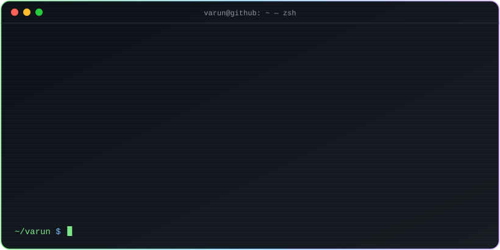

<!-- ░░ HEADER ░░ -->
<p align="center">
  
</p>

<p align="center">
  <a href="https://github.com/vrbalbudhe">
    
  </a>
</p>

<p align="center">
  
  
  
</p>

<!-- ░░ CUSTOM ANIMATED TERMINAL ░░ -->
<p align="center">
  
</p>

## 🧬 About Me

```java
public class Varun extends Engineer {
    String role       = "Full Stack Software Engineer";
    String[] focus    = { "Backend Systems", "Multi-Tenant SaaS", "Real-time Apps", "Web3" };
    String experience = "SDE Intern — Java · Hibernate · API Testing · Security Patching";
    String currently  = "Building WorkSync — an HR platform with a database per tenant";
    String motto      = "Make it work, make it right, make it fast.";
}
```

## 🛠️ Tech Arsenal

<p align="center">
  <br/>
  <br/>
  <br/>
  <br/>
  
</p>

## 🏗️ Under the Hood — WorkSync

<p align="center">
  
</p>

> **WorkSync** is a multi-tenant HR & workforce SaaS — employees, leave workflows, holiday calendars, broadcasts, ticketing and scheduled PDF/Excel reports — secured with **JWT + RBAC + TOTP MFA**, built on **Spring Boot · Hibernate · PostgreSQL · React**.

## 🚀 Featured Builds

| Project | What it does | Stack |
|---|---|---|
| 🏢 **WorkSync** | Multi-tenant HR SaaS, isolated DB per org, RBAC, MFA, reports | `Spring Boot` `Hibernate` `PostgreSQL` `React` |
| 🧵 **[NXTHREADS](https://github.com/vrbalbudhe/NXTHREADS)** | Writing & social platform with threads, real-time chat and notifications | `React` `Node.js` `Prisma` `MongoDB` `Redis` `Socket.IO` |
| ⛓️ **[TransactETH](https://github.com/vrbalbudhe/Transact_ETH)** | Ethereum dApp with direct + escrow-protected transfers on Sepolia | `Solidity` `TypeScript` `MetaMask` |
| 📋 **[KanbanFlow](https://github.com/vrbalbudhe/Kanbanflow)** | Drag-and-drop Kanban board for project management | `React` `Node.js` `Docker` |
| 📱 **[Smart QR Attendance](https://github.com/vrbalbudhe/Smart-QR-Based-Attendence-System)** | QR-code based attendance tracking | `Next.js` `TypeScript` `Docker` |
| 📦 **[WMS](https://github.com/vrbalbudhe/WMS)** | Warehouse management system | `JavaScript` `Docker` |

## 📊 GitHub Pulse

<p align="center">
  
  
</p>

<p align="center">
  
</p>

## 🐍 Eating My Contributions

<p align="center">
  <picture>
    <source media="(prefers-color-scheme: dark)" srcset="https://raw.githubusercontent.com/vrbalbudhe/vrbalbudhe/output/github-contribution-grid-snake-dark.svg" />
    <source media="(prefers-color-scheme: light)" srcset="https://raw.githubusercontent.com/vrbalbudhe/vrbalbudhe/output/github-contribution-grid-snake.svg" />
    
  </picture>
</p>

## 🤝 Let's Connect

<p align="center">
  <a href="https://github.com/vrbalbudhe"></a>
  <a href="https://www.linkedin.com/in/YOUR-LINKEDIN"></a>
  <a href="mailto:YOUR-EMAIL"></a>
</p>


